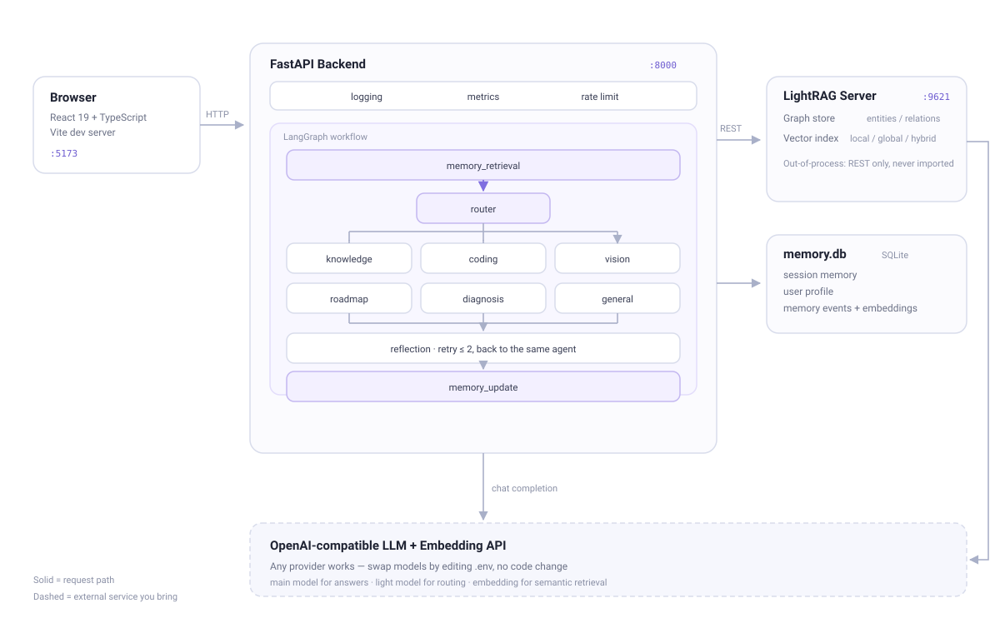

# memory-agent

[English](README.md) | **简体中文**

[](https://github.com/007350/memory-agent/actions/workflows/ci.yml)
[](LICENSE)
[](https://www.python.org/)
[](https://react.dev/)
[](https://github.com/007350/memory-agent/stargazers)

面向 AI / Computer Science 学习和代码辅助的**多 Agent 知识助手**，基于 **LangGraph + LightRAG + FastAPI + React** 构建。

和常见的 RAG Demo 不同，它没有停在「检索 → 回答」这一步：每条问题先被路由到专门的 Agent，跨会话记住你，能为一本书规划学习路线，也能诊断你到底学到哪了。而且**降级优先于崩溃**——知识图谱服务或 Embedding 接口挂了，它会退回纯 LLM 或关键词检索，而不是直接报错。



---

## 目录

- [功能特性](#功能特性)
- [快速开始](#快速开始)
- [配置说明](#配置说明)
- [一次请求的完整流转](#一次请求的完整流转)
- [记忆系统](#记忆系统)
- [学习路线与学习诊断](#学习路线与学习诊断)
- [API 一览](#api-一览)
- [目录结构](#目录结构)
- [测试与评测](#测试与评测)
- [已知限制](#已知限制)
- [常见问题](#常见问题)
- [参与贡献](#参与贡献)
- [许可证](#许可证)

---

## 功能特性

| 能力 | 说明 |
|---|---|
| **多 Agent 路由** | 轻量模型把问题分到 `knowledge` / `coding` / `vision` / `roadmap` / `diagnosis` / `general`，并对意图敏感的问题做关键词兜底，避免误判 |
| **Graph RAG** | LightRAG 构建实体关系图，支持 `local` / `global` / `hybrid` 三种检索模式 |
| **学习路线规划** | 从问题中提取主题 → 知识库检索 → 生成 5~10 步结构化路线 → 落库并追踪每一步完成状态 |
| **学习诊断** | 把路线进度 + 用户画像 + 近期记忆事件合成一份报告：总体进度 / 强项 / 薄弱点 / 下一步建议 |
| **三层记忆** | SQLite 持久化：会话记忆、长期用户画像、记忆事件流（带反馈与过期标记） |
| **语义去重** | 同一偏好换个说法不会重复堆积；用户改口时旧记录标记过期、由新记录取代 |
| **自我反思** | 答案质量不达标（<20 字或含 "No relevant context"）时重试，且**回到原 Agent**，最多 2 次 |
| **Tool Use** | `python_repl` 代码执行 + Firecrawl 网络搜索，调用过程在 UI 上可视化 |
| **可观测性** | 请求数/延迟指标、结构化日志、限流中间件，以及 30 题端到端评测 |

---

## 快速开始

**前置要求**：Python 3.11+、Node.js 18+，以及任意 OpenAI 兼容的 **LLM** 和 **Embedding** API（StepFun / OpenAI / 硅基流动 / vLLM / Ollama 均可）。

### 1. 安装

```bash
git clone https://github.com/007350/memory-agent.git
cd memory-agent

python -m venv .venv
source .venv/bin/activate          # Windows: .venv\Scripts\activate

pip install -r backend/requirements.txt
pip install "lightrag-hku[api]==1.5.6"   # LightRAG Server，独立进程
cd frontend && npm install && cd ..
```

### 2. 配置

```bash
cp backend/.env.example backend/.env
cp lightrag/.env.example lightrag/.env
# 编辑这两个文件，填入你的 LLM / Embedding 密钥
```

真正必填的只有这几项：

```env
LLM_BASE_URL=...        LLM_API_KEY=...         LLM_MODEL_MAIN=...
EMBEDDING_BASE_URL=...  EMBEDDING_API_KEY=...   EMBEDDING_MODEL=...
```

> `backend/.env` 控制助手行为，`lightrag/.env` 控制图谱索引。两者可以用不同模型——但 `lightrag/.env` 里的 Embedding 模型在**建立索引后不可更换**。

### 3. 启动

```bash
# Windows
start.bat

# macOS / Linux
chmod +x start.sh && ./start.sh
```

两个脚本都会自动探测解释器（`MEMORYAGENT_PYTHON` → `.venv` → `PATH`），然后拉起三个服务。访问 **http://localhost:5173**。

也可以手动分别启动：

```bash
cd lightrag && lightrag-server                     # :9621
cd backend  && uvicorn app.main:app --port 8000     # :8000
cd frontend && npm run dev                         # :5173
```

或者用 Docker：

```bash
docker compose up
```

### 4. 灌点文档

在「知识库」页粘贴文本，或上传自带的 5 篇示例文档：

```bash
python upload_docs.py
```

建索引是异步的，大文档 1~5 分钟，进度看 http://localhost:9621。

---

## 配置说明

所有配置都在两个 `.env` 里，源码中没有硬编码。完整注释见 `backend/.env.example` 和 `lightrag/.env.example`。值得关注的几个：

| 变量 | 默认值 | 作用 |
|---|---|---|
| `LLM_MODEL_MAIN` / `LLM_MODEL_LIGHT` | step-3.7-flash / step-3.5-flash | 回答用主力模型，路由用轻量模型，省成本降延迟 |
| `MEMORY_SEMANTIC_TOP_K` | 20 | 每轮最多检索多少条记忆事件 |
| `MEMORY_DECAY_HALF_LIFE_DAYS` | 14 | 记忆时间衰减半衰期（天） |
| `MEMORY_CONTEXT_BUDGET_CHARS` | 3000 | 注入 prompt 的记忆文本硬上限 |
| `PYTHON_REPL_TIMEOUT` | 5 | `python_repl` 执行超时（秒） |

换 LLM 供应商只需改三行，不用动代码。

---

## 一次请求的完整流转

```
query
  └─ memory_retrieval   加载会话记忆 + 给记忆事件打分
       └─ router        选 Agent（轻量模型 + 关键词兜底）
            ├─ knowledge   LightRAG hybrid 检索 → LLM
            ├─ coding      写代码 / 调试
            ├─ vision      图片理解
            ├─ roadmap     抽主题 → 检索 → 5~10 步路线 → SQLite
            ├─ diagnosis   进度 + 画像 + 事件 → 诊断报告
            └─ general     闲聊 / 实时问题（可调网络搜索）
                 └─ reflection   质量检查，失败则回原 Agent 重试（≤2 次）
                      └─ memory_update   持久化事实与偏好
```

路由层不信任 LLM 自填的模型名，统一从 `services/model_registry.py` 取——所以模型「幻觉」出一个不存在的模型名也不会打挂请求。

---

## 记忆系统

三层记忆互相隔离，全部存在 SQLite（`aiosqlite`）里，不依赖外部记忆服务：

| 层 | 作用域 | 用途 |
|---|---|---|
| 会话记忆 | 按 `session_id` | 本次对话中的关键事实与偏好 |
| 用户画像 | 按 `user_id` | 跨会话存活的长期特征 |
| 记忆事件 | 按 `user_id` | 只追加的日志，带反馈与过期标记 |

检索不是简单的余弦相似度，而是加权混合：

```
score = 0.55 · 语义余弦相似度
      + 0.25 · 关键词覆盖率   （字符 bigram，中文可用）
      + 0.10 · importance
      + 0.10 · 时间衰减       （0.5 ^ (age_days / half_life)）
```

Embedding 接口不可用时，权重会按比例还给其余项，检索静默退化为关键词。**Embedding 挂了只会让记忆变笨，不会让功能挂掉。**

---

## 学习路线与学习诊断

**学习路线**——说一句「帮我规划 LangGraph 的学习路线」：

1. 轻量模型抽出主题（`doc_name`）；
2. 拿主题去 LightRAG 做 hybrid 检索（服务不可用时降级为占位上下文，不中断）；
3. 主力模型必须返回 5~10 步的 JSON 数组——逐条校验，缺标题的丢弃，步骤 id 强制重排；
4. 写入 `learning_roadmaps` 表，并渲染成 Markdown 回给用户。

前端可以勾选完成、删除、重新规划；`RoadmapStats` 用纯手写 SVG 画完成率环形图，没有引入图表库。

**学习诊断**——问一句「我学得怎么样」：路线进度 + 用户画像 + 最近 50 条记忆事件塞进同一个 prompt，产出一份含总体进度、强项、薄弱点、下一步建议的报告。

---

## API 一览

交互式文档：http://localhost:8000/docs

| 分组 | 接口 |
|---|---|
| 对话 | `POST /chat` |
| 文档 | `POST /documents`、`POST /documents/upload`、`GET /documents/{track_id}/status` |
| 学习路线 | `GET /roadmaps`、`GET /roadmaps/{id}`、`PATCH /roadmaps/{id}/steps/{step_id}`、`DELETE /roadmaps/{id}` |
| 记忆 | `GET /memory/{session_id}`、`DELETE /memory`、画像 CRUD + `/summary` + `/rollback`、事件 + `/feedback` |
| 运维 | `GET /health`、`GET /metrics` |

```bash
curl -X POST http://localhost:8000/chat \
  -H "Content-Type: application/json" \
  -d '{"query":"LangGraph 是什么？","session_id":"s1","user_id":"u1"}'
```

```json
{
  "answer": "LangGraph 是一个用于构建有状态多参与者应用的框架……",
  "agent": "knowledge",
  "sources": [{"id": "chunk-001", "file_path": "langgraph_overview", "content": "..."}],
  "retrieval_mode": "hybrid",
  "reflection_passed": true,
  "reflection_count": 0,
  "used_memories": [],
  "latency": 5.3,
  "session_id": "s1"
}
```

---

## 目录结构

```
backend/app/
  main.py              FastAPI 装配：中间件、路由、生命周期
  config.py            pydantic-settings，只读环境变量
  graph/               LangGraph：state / nodes / workflow
  agents/              router + 6 个专用 Agent
  services/            lightrag_client、memory_service、embedding_service、model_registry
  tools/               python_repl、web_search
  routes/              chat、documents、memory、roadmap、health、metrics
  middleware/          logging、metrics、rate_limit
frontend/src/          React 19 + TS：ChatPage、KnowledgePage、RoadmapPage
lightrag/              LightRAG Server 配置 + 本地索引（不进 Git）
docs/                  架构图
```

---

## 测试与评测

```bash
cd backend
python -m pytest tests/ --ignore=tests/evaluation -q   # 112 passed, 3 skipped，不触网
python -m pytest tests/ -m integration                 # 需要 LightRAG 在 :9621 运行
python tests/evaluation/eval_rag.py                    # 30 题端到端评测
```

测试**完全离线**：LLM 与 HTTP 调用全部 mock，Embedding 用 fixture 关掉，数据库测试每个用例分配独立的 `tmp_path`，不会互相污染。

最近一次端到端评测——7 篇文档、30 道题（LangGraph、LightRAG、RAG Survey、Python 异步、Transformer……）：

| 类别 | 得分 |
|---|---|
| simple（简单问答） | 10/10 |
| cross_doc（跨文档） | 10/10 |
| multi_hop（多跳推理） | 5/5 |
| unanswerable（应拒答） | 5/5 |
| **合计** | **30/30** |

检索命中率 96%（29/30），平均延迟 27.4s——hybrid 图谱检索加上反思节点要走多轮 LLM，首问 10~30s 属正常。

---

## 已知限制

- **单用户假设**：没有鉴权层，`user_id` 由前端传入，不要直接暴露到公网。
- **`python_repl` 不是真沙箱**：只是带超时的子进程，不能当安全边界用。
- **延迟偏高**：串行 LLM 调用较多，流式只在 UI 侧做了部分处理。
- **评测是小样本**：30 题是回归护栏，不是 benchmark。

---

## 常见问题

**Q: `lightrag-server not found`**

先确认装在同一环境里：`pip install "lightrag-hku[api]==1.5.6"`。`start.bat` 会从当前解释器的 `Scripts\` 目录找 `lightrag-server.exe`；如果 Python 装在别处，也可以 `set MEMORYAGENT_PYTHON=<python.exe 完整路径>` 后再运行。

**Q: 上传文档后检索不到内容**

1. 确认文档状态是 `processed`（http://localhost:9621 查看）；
2. 大文档建图要 1~5 分钟；
3. 看 LightRAG 窗口日志有没有报错。

**Q: 换了 Embedding 模型后检索全乱**

Embedding 模型与索引是绑定的。要换必须清空 `lightrag/data/` 重新灌文档，并同步修改 `lightrag/.env` 里的 `EMBEDDING_DIM`。

**Q: 回答超过 30 秒**

正常。hybrid 检索要多次 LLM 调用（关键词抽取 + 图谱查询 + 答案生成），再加反思节点。开启 LLM 缓存后重复问题会明显变快。

**Q: 前端显示「后端服务异常」**

依次 `curl http://localhost:8000/health`、`curl http://localhost:9621/health`，再看 Backend 窗口日志。

**Q: 不小心把 `.env` 提交了**

`.env` 已在 `.gitignore` 中。若曾用 `git add -f` 强加，用 `git rm --cached backend/.env lightrag/.env` 撤销跟踪，并**立刻轮换泄露的密钥**。

---

## 参与贡献

欢迎 Issue 和 PR。动手前请先读 [CONTRIBUTING.md](CONTRIBUTING.md)——里面有怎么加一个 Agent、怎么本地跑测试，以及 CI 会检查什么。

## 许可证

[MIT](LICENSE) © 2026 007350
